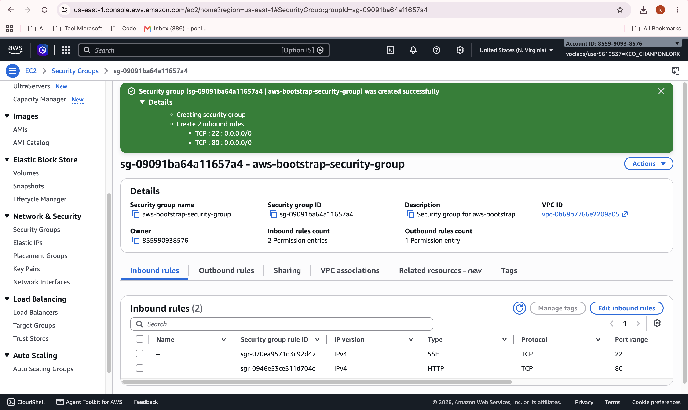
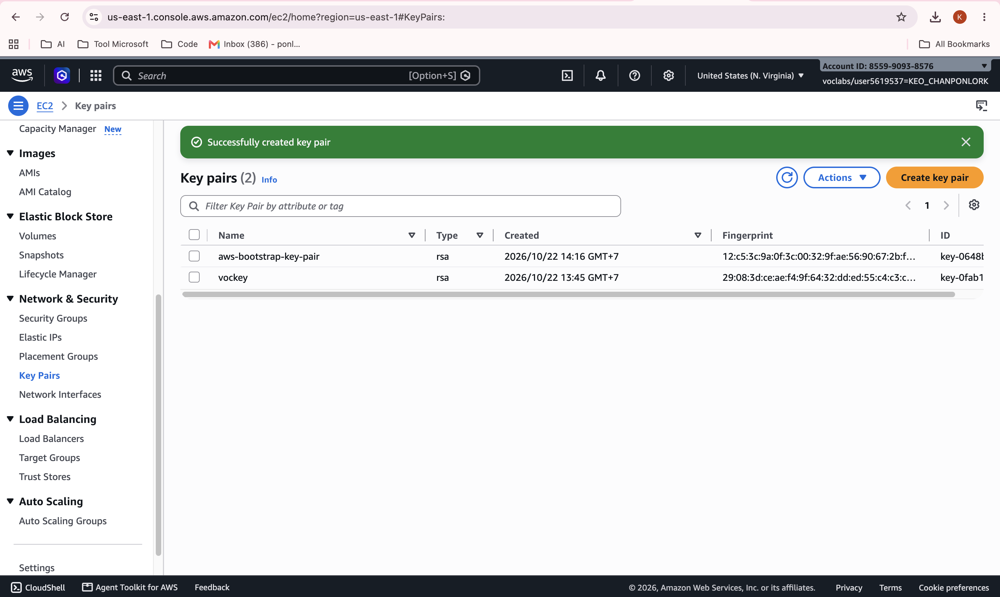
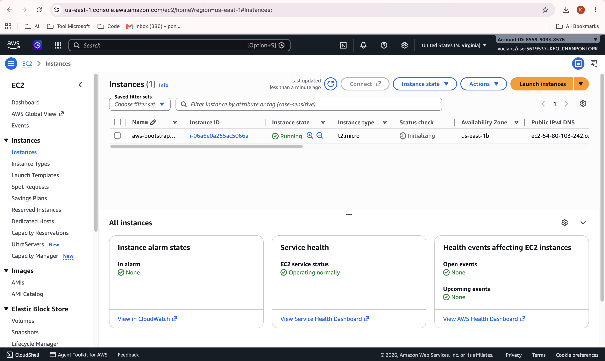
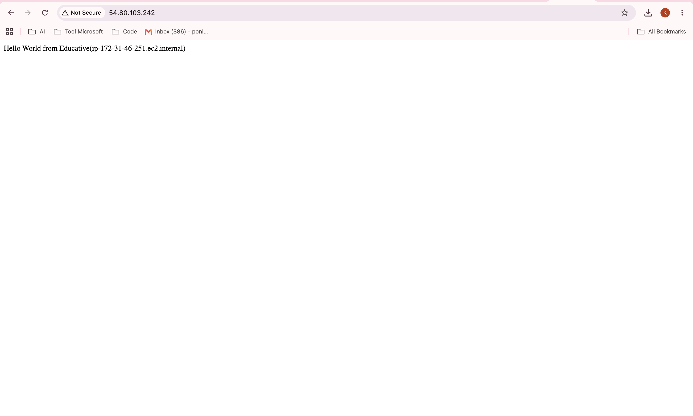
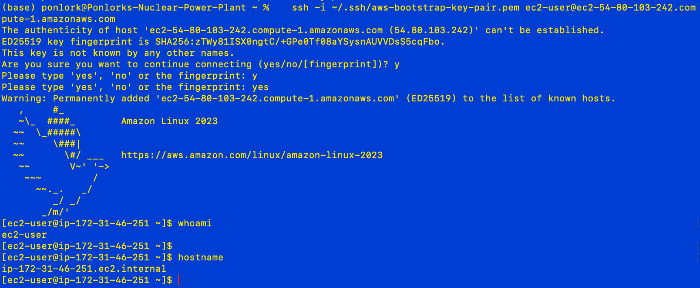

# Cloud Lab 1 — Amazon EC2

- **Student name:** Keo Chanponlork
- **Student ID:** e20220660
- **Learner Lab user name:** voclabs/user5619537=KEO_CHANPONLORK
- **Date completed:** 2026-10-22

---

## Part 1.1 — An Amazon EC2 Walkthrough

### 1. Security group

I created `aws-bootstrap-security-group` with two inbound rules: SSH on port 22 and HTTP on port 80.

### 2. Key pair

I created the RSA key pair `aws-bootstrap-key-pair` in `.pem` format to log in to the instance over SSH.

### 3. Instance details

The instance `aws-bootstrap-instance` is a `t2.micro` and is _Running_, with public IP `54.80.103.242`.

### 4. Browser test

Opening `http://54.80.103.242` in the browser shows the _Hello World from Educative_ page from the web server.

### 5. SSH connection

I connected from my Mac terminal with SSH. `whoami` shows `ec2-user` and `hostname` shows `ip-172-31-46-251.ec2.internal`.
