# Cloud Lab 1 — Amazon EC2

- **Student name:** Keo Chanponlork
- **Student ID:** e20220660
- **Learner Lab user name:** voclabs/user5619537=KEO_CHANPONLORK
- **Date completed:** 2026-10-22

---

## Part 1.1 — An Amazon EC2 Walkthrough

### 1. Security group

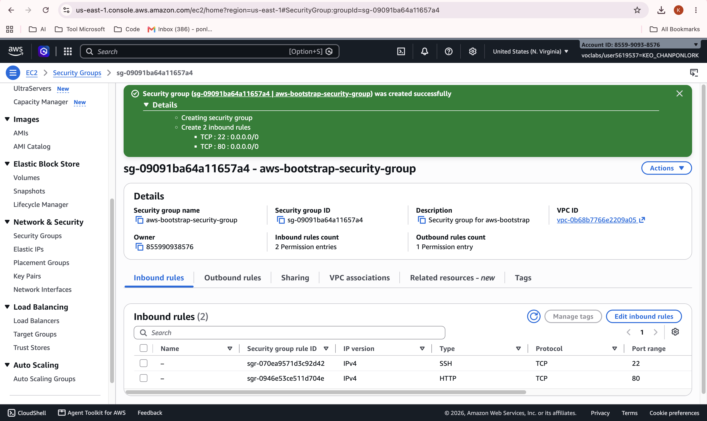

I created `aws-bootstrap-security-group` with two inbound rules: SSH on port 22 and HTTP on port 80.

### 2. Key pair

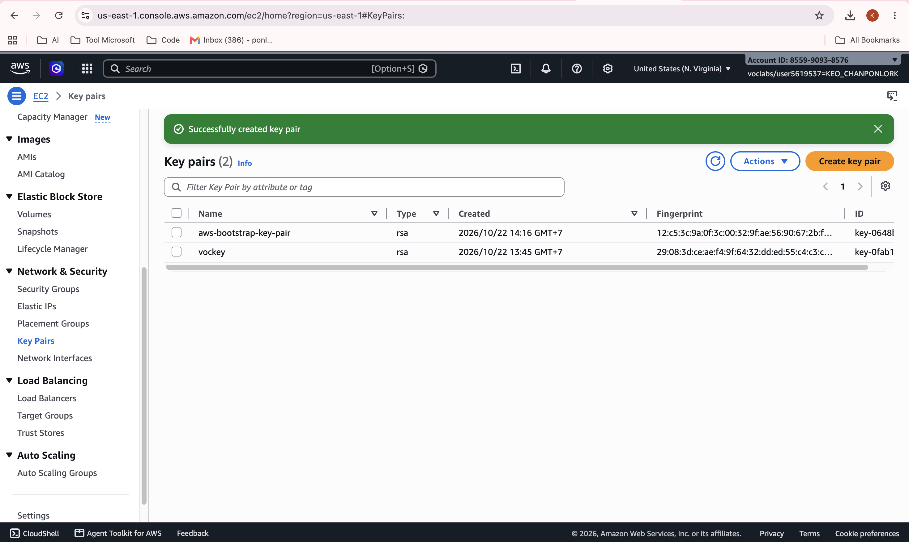

I created the RSA key pair `aws-bootstrap-key-pair` in `.pem` format to log in to the instance over SSH.

### 3. Instance details

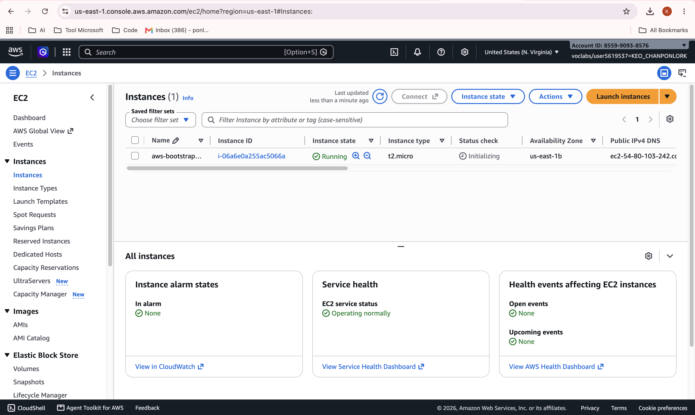

The instance `aws-bootstrap-instance` is a `t2.micro` and is _Running_, with public IP `54.80.103.242`.

### 4. Browser test

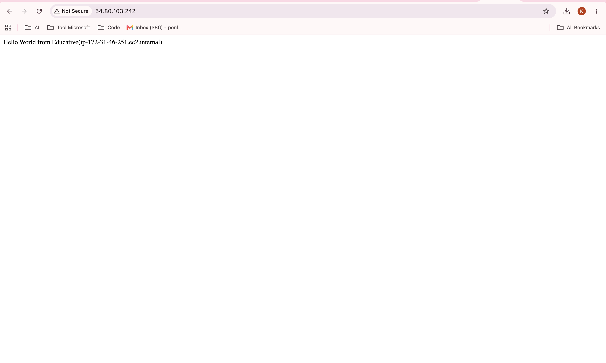

Opening `http://54.80.103.242` in the browser shows the _Hello World from Educative_ page from the web server.

### 5. SSH connection

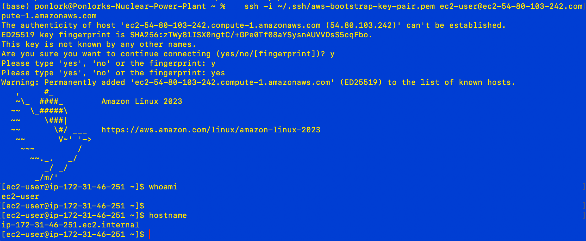

I connected from my Mac terminal with SSH. `whoami` shows `ec2-user` and `hostname` shows `ip-172-31-46-251.ec2.internal`.

---

## Part 1.2 — Set Up an EC2 Web Solution (Challenge)

### 6. Challenge launch

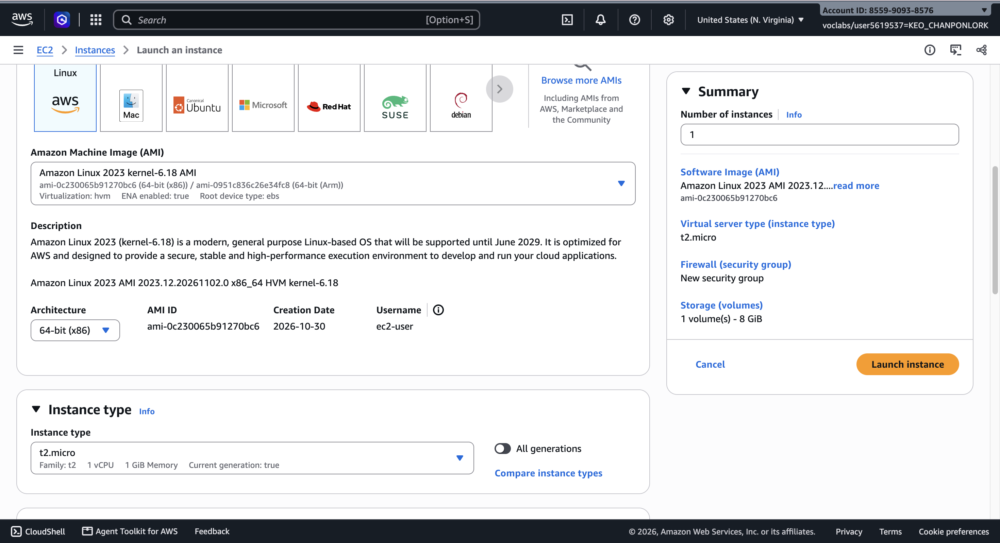

I launched the instance `ec2-challenge-instance` with the Amazon Linux 2023 AMI (64-bit x86), type `t2.micro`, the new key pair `ec2-challenge-key-pair`, and a 10 GiB gp3 root volume.

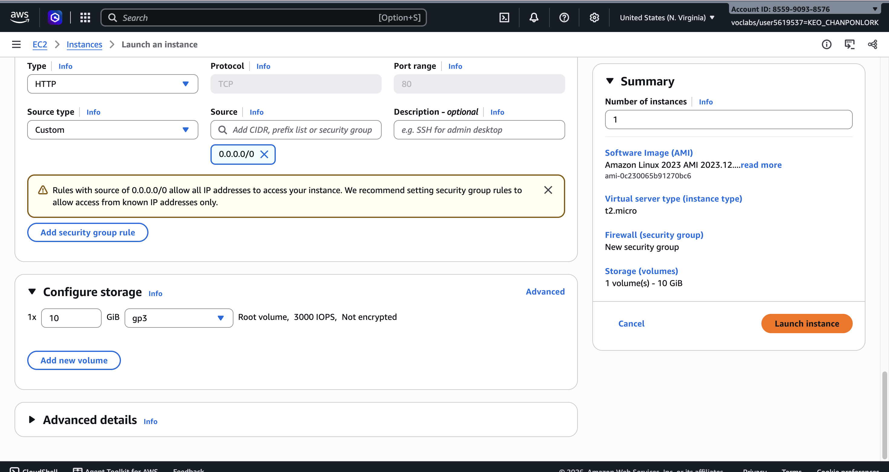

### 7. Challenge security group

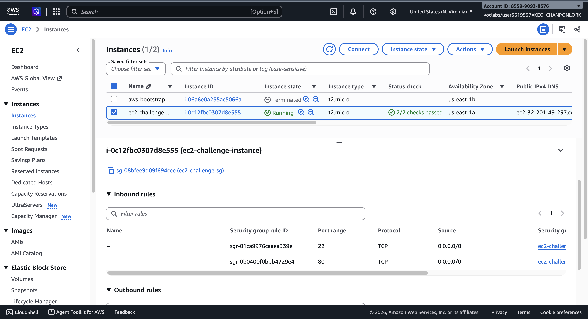

I created `ec2-challenge-sg` with two inbound rules from Anywhere-IPv4: SSH on port 22 for remote configuration and HTTP on port 80 for web access.

### 8. Challenge instance

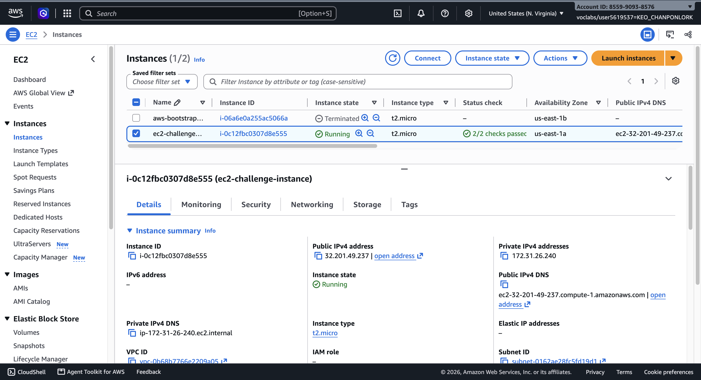

The instance `ec2-challenge-instance` is _Running_, with public IP `54.234.152.20`.

### 9. Challenge terminal

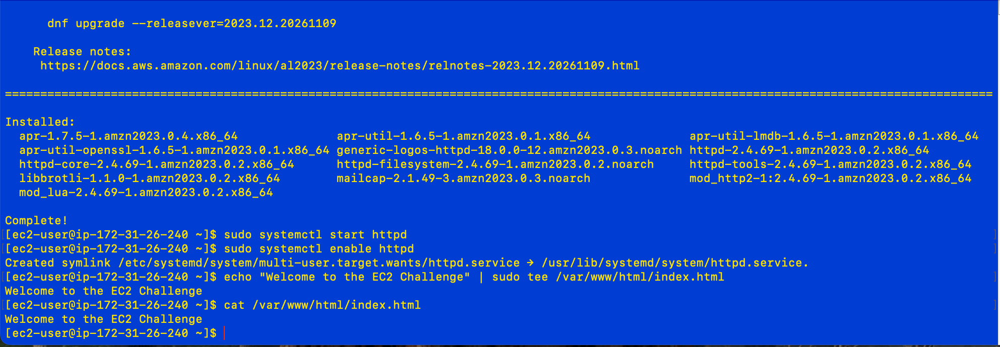

I connected over SSH from my Mac terminal and installed Apache by hand:

    ssh -i ~/.ssh/ec2-challenge-key-pair.pem ec2-user@ec2-54-234-152-20.compute-1.amazonaws.com
    sudo dnf update -y
    sudo dnf install -y httpd
    sudo systemctl start httpd
    sudo systemctl enable httpd
    echo "Welcome to the EC2 Challenge" | sudo tee /var/www/html/index.html
    cat /var/www/html/index.html

### 10. Challenge browser

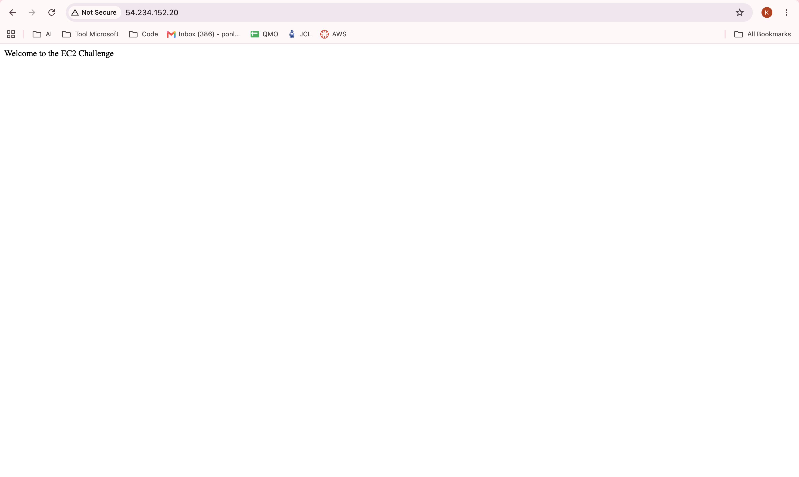

Opening `http://54.234.152.20` in the browser shows the _Welcome to the EC2 Challenge_ page.