# Cloud Lab 2 — Application Load Balancer with an EC2 Auto Scaling Group

- **Student name:** Keo Chanponlork
- **Student ID:** e20220660
- **Learner Lab user name:** voclabs/user5619537=KEO_CHANPONLORK
- **Date completed:** 2026-11-19

---

## Task 1 — Security Groups

### 1. Load balancer security group

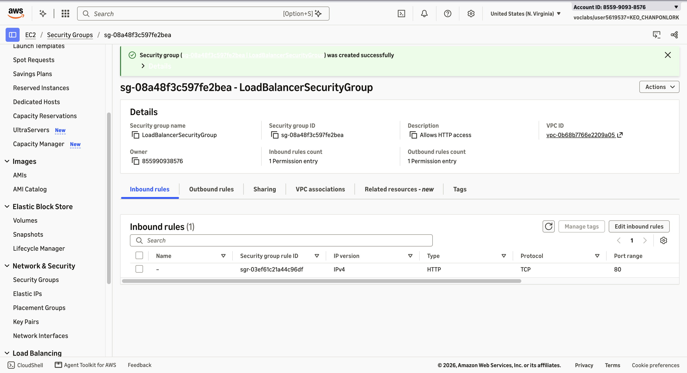

I created `LoadBalancerSecurityGroup` (`sg-08a48f3c597fe2bea`) in the default VPC with the description *Allows HTTP access* and one inbound rule: HTTP on port 80 from Anywhere-IPv4 (`0.0.0.0/0`).

### 2. Launch template security group

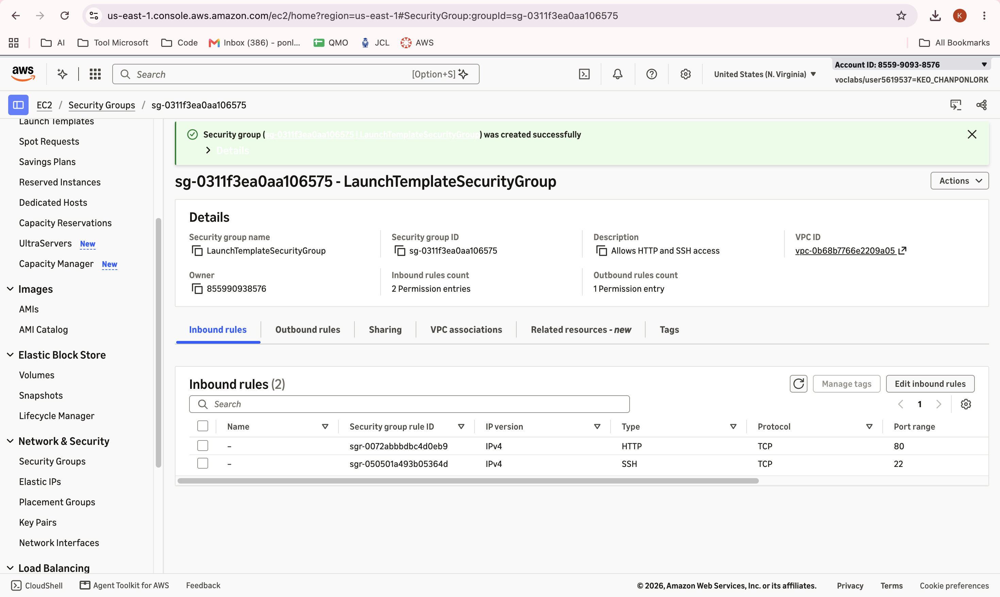

I created `LaunchTemplateSecurityGroup` (`sg-0311f3ea0aa106575`) in the default VPC with the description *Allows HTTP and SSH access* and two inbound rules from Anywhere-IPv4: HTTP on port 80 and SSH on port 22.

---

## Task 2 — Target Group

### 3. Target group details

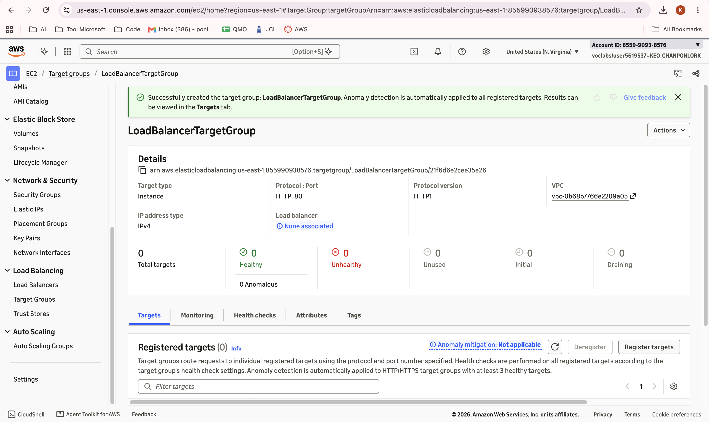

I created `LoadBalancerTargetGroup` with target type *Instance*, protocol and port `HTTP: 80`, protocol version HTTP1, IPv4, in the default VPC. I registered no targets, because the Auto Scaling group registers its instances automatically.

### 4. Health checks

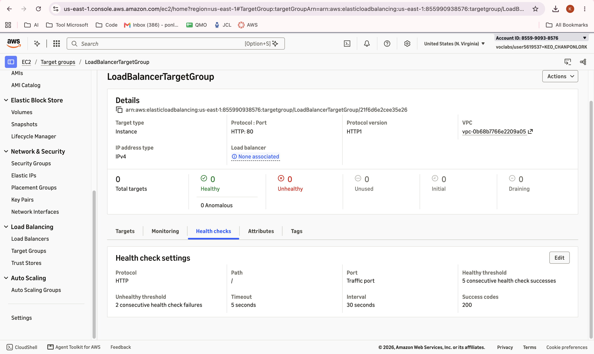

I kept the default health check settings: protocol HTTP, path `/`, interval 30 seconds, timeout 5 seconds, success code 200, healthy threshold 5 successes and unhealthy threshold 2 failures.

---

## Task 3 — Application Load Balancer

### 5. Load balancer list

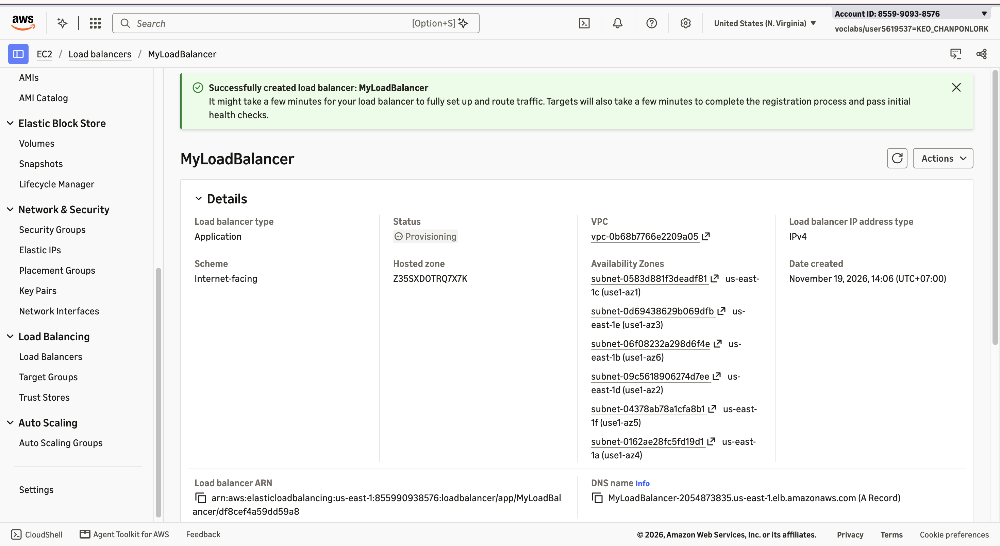

I created the Application Load Balancer `MyLoadBalancer`. Its state changed from *Provisioning* to *Active* after a few minutes.

### 6. Load balancer details

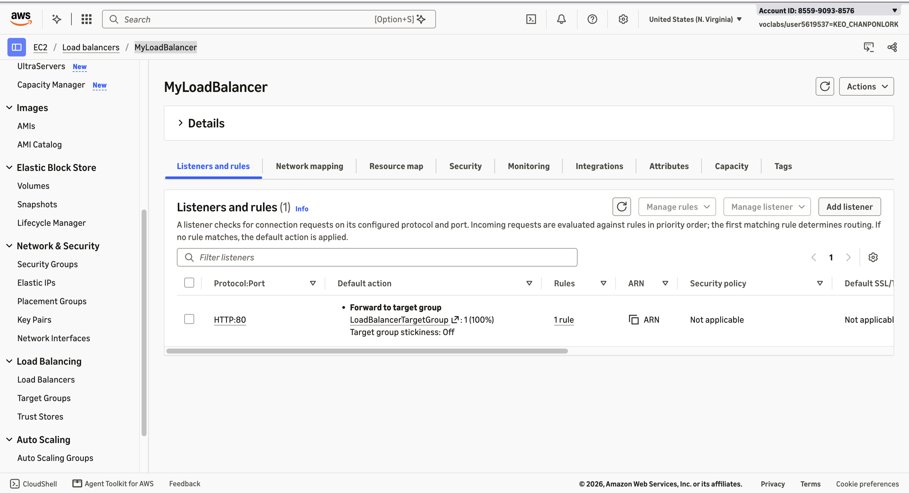

`MyLoadBalancer` is *Internet-facing*, uses IPv4 in the default VPC, and is mapped to all six Availability Zones (us-east-1a to us-east-1f). It uses the security group `LoadBalancerSecurityGroup`. Its listener `HTTP:80` forwards to `LoadBalancerTargetGroup`. Its DNS name is `MyLoadBalancer-2054873835.us-east-1.elb.amazonaws.com`.

---

## Task 4 — Auto Scaling Group

### 7. Launch template

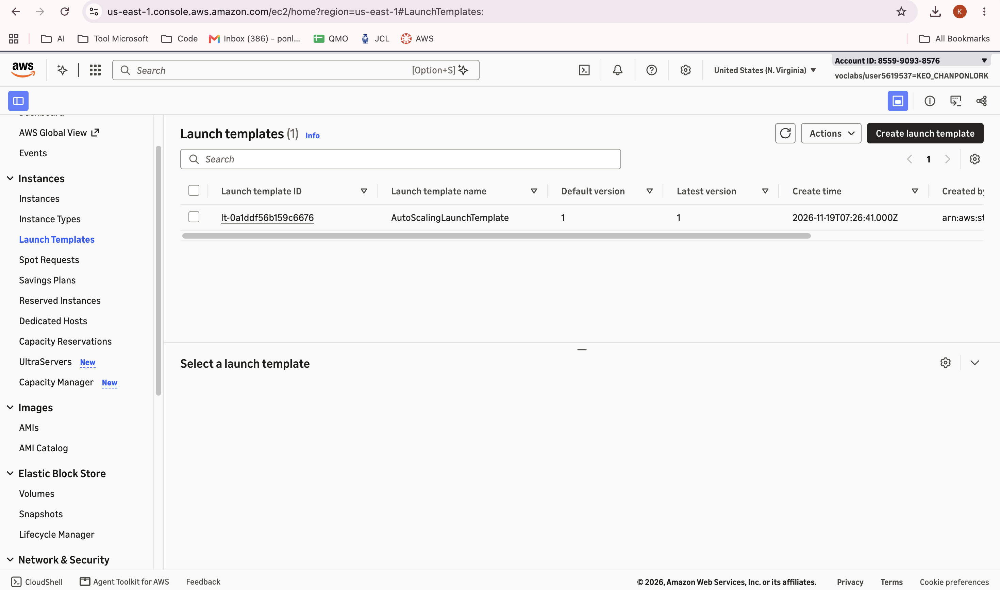

I created the launch template `AutoScalingLaunchTemplate` (`lt-0a1ddf56b159c6676`) with the Amazon Linux 2023 AMI (`ami-06f98347e4f9c7328`), instance type `t2.micro`, the security group `LaunchTemplateSecurityGroup`, and a user data script that installs and starts `httpd` and writes *Hello World from (hostname)* to `index.html`.

### 8. Auto Scaling group list

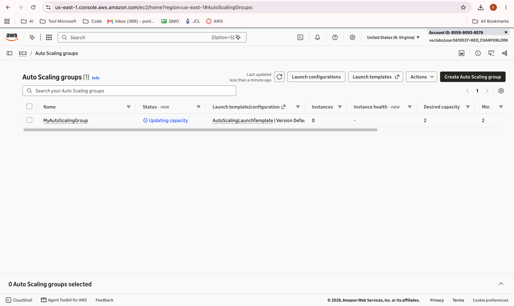

I created the Auto Scaling group `MyAutoScalingGroup` from `AutoScalingLaunchTemplate`, in all Availability Zones of the default VPC, attached to `LoadBalancerTargetGroup`, with Elastic Load Balancing health checks turned on.

### 9. Auto Scaling group details

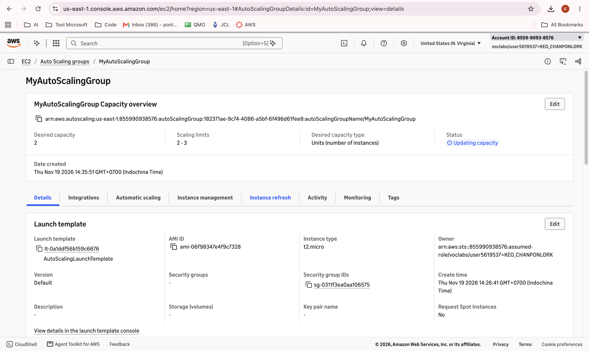

The group has desired capacity 2 and scaling limits 2–3 (minimum 2, maximum 3), and its target group is `LoadBalancerTargetGroup`.

---

## Task 5 — Putting It All Together

### 10. Browser test (first request)

When both targets were healthy, I opened `http://myloadbalancer-2054873835.us-east-1.elb.amazonaws.com`. The page showed *Hello World from (ip-172-31-82-41.ec2.internal)*.

### 11. Browser test (after refreshing)

After refreshing, the same address showed *Hello World from (ip-172-31-12-253.ec2.internal)*, a different host name. The load balancer sends requests to different instances.

### 12. Stopping the web server

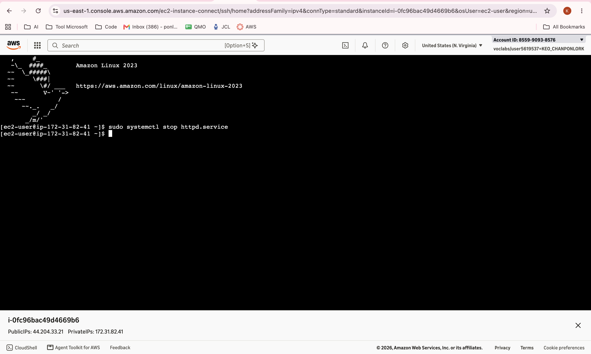

I connected to instance `i-0fc96bac49d4669b6` (private IP `172.31.82.41`) with EC2 Instance Connect and ran `sudo systemctl stop httpd.service`. The instance kept running, but its web server stopped answering.

### 13. Unhealthy target

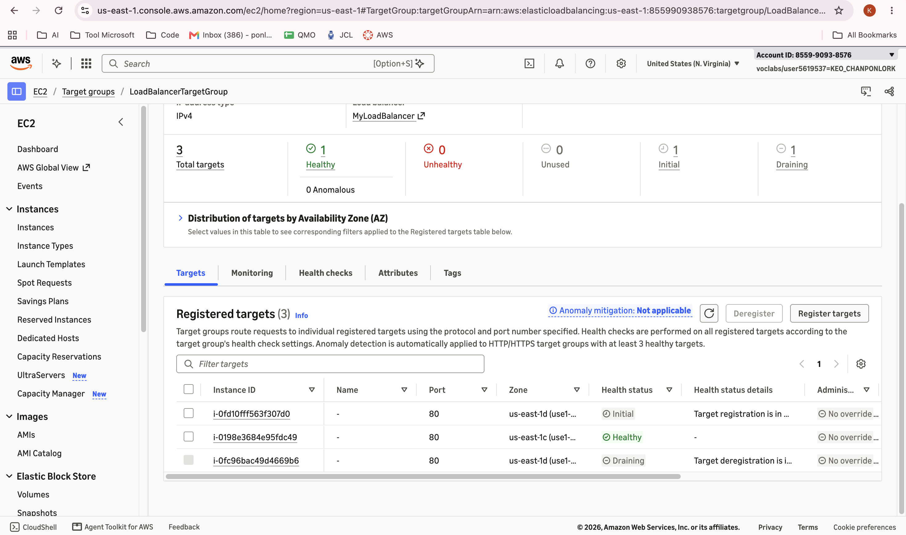

After two failed health checks, `i-0fc96bac49d4669b6` was taken out of service and became *Draining* while it was deregistered from the target group.

### 14. Replacement target

The Auto Scaling group launched a new instance, `i-0fd10fff563f307d0`. It went from *Initial* to *Healthy* after passing its health checks, so the group again had two healthy targets: `i-0fd10fff563f307d0` and `i-0198e3684e95fdc49`.

---

## Task 6 — Clean Up

After taking all screenshots, I deleted `MyAutoScalingGroup`, `AutoScalingLaunchTemplate`, `MyLoadBalancer`, `LoadBalancerTargetGroup`, `LoadBalancerSecurityGroup` and `LaunchTemplateSecurityGroup`, in that order.